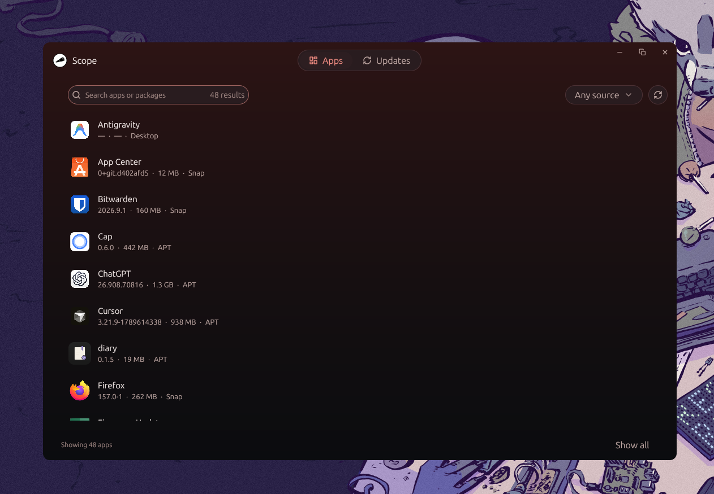

<p align="center">
  
</p>

<h1 align="center">Scope for Linux</h1>

<p align="center">Browse, update, and uninstall Linux apps in one place.</p>

<p align="center">
  <a href="https://khurrambhutto.github.io/scope/">Website</a> ·
  <a href="https://github.com/khurrambhutto/scope/releases">Downloads</a> ·
  <a href="https://github.com/khurrambhutto/scope/issues">Report an issue</a>
</p>

Scope for Linux brings installed apps, command-line tools, and Steam games into one searchable list. Inspect app details and preview updates or removals before confirming. Ubuntu on x86-64 is the primary target.

<p align="center">
  
  
</p>

## Install

Download the `.deb` or AppImage from [Releases](https://github.com/khurrambhutto/scope/releases). For the v0.3.8 `.deb`, run:

```bash
sudo apt install ./scope_0.3.8_amd64.deb
```

For the portable AppImage:

```bash
chmod +x Scope-0.3.8-x86_64.AppImage
./Scope-0.3.8-x86_64.AppImage
```

Official `.deb` builds support verified self-updates.

## Usage

Search or filter by source, select an app, then choose **Update** or **Uninstall**. Review the preview and confirm. Operations that need administrator access prompt for authentication.

Use **Updates** to see available updates and **Show all** to include packages hidden from the default app list. Protected packages remain locked.

APT apps with visible app-menu launchers appear even when installed automatically. They use the same update and uninstall previews as other APT apps. Uninstall previews warn when other apps or desktop features may depend on them.

APT uninstall, including apps installed from `.deb` files, removes the app and its package configuration using purge. Personal settings, profiles, caches, and other data in your home directory remain. Scope does not run autoremove.

To install a downloaded `.deb` or AppImage, choose **Open With → Scope** and review the installation preview. AppImages are added to your app menu and stored in `~/AppImages`.

## Supported sources

| Source | Uninstall | Update |
| --- | --- | --- |
| APT, Snap, Flatpak | Yes | Yes |
| uv tools, pipx, Cargo | Yes | Yes |
| npm global, Bun global | Yes | Yes |
| AppImage in `~/AppImages` (installed by Scope or Gear Lever) | Yes | Yes, when the AppImage publishes update information |
| Other AppImages, unmanaged desktop launchers | Discovery only | Discovery only |
| Steam games | Read-only | Open in Steam |
| JetBrains Toolbox IDEs | Read-only | Open Toolbox |

Tool management supports verified installations in your home directory. Update availability depends on the package source and installation method. AppImage integration requires `squashfs-tools`; most AppImages also need `libfuse2t64` to run.

JetBrains Toolbox IDEs are discovered read-only from local Toolbox metadata. **Open Toolbox** starts the installed Toolbox launcher only when selected; IDE updates, uninstalls, and footprint measurement are unavailable in Scope.

## Build from source

Install Rust stable and the Linux dependencies, then run:

```bash
sudo apt install build-essential pkg-config libfontconfig1-dev libx11-dev libx11-xcb-dev \
  libxcb1-dev libxkbcommon-dev libxkbcommon-x11-dev libwayland-dev wayland-protocols
git clone https://github.com/khurrambhutto/scope.git
cd scope
cargo run
```

## Contributing

See [CONTRIBUTING.md](CONTRIBUTING.md) for setup, checks, and pull request guidelines. [AGENTS.md](AGENTS.md) describes the architecture and safety rules. Report bugs through [Issues](https://github.com/khurrambhutto/scope/issues) and security vulnerabilities through [SECURITY.md](SECURITY.md).

## License

[MIT](LICENSE)
